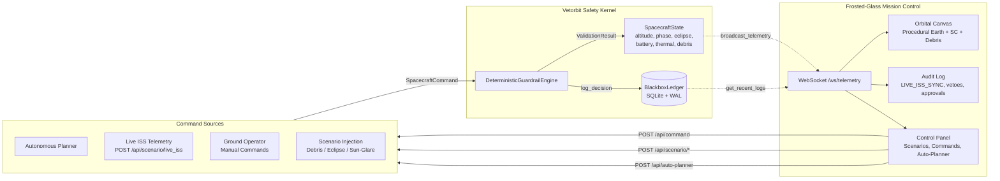

# Vetorbit

**Deterministic Spacecraft Command Safety Kernel & Conjunction Avoidance Sandbox**

A flight-software-grade safety layer that sits between autonomous AI planners and spacecraft hardware, enforcing hard physical guardrails on every command before it reaches the bus.

---

## 1. Why Deterministic Guardrails Are Mandatory

Autonomous planners (RL agents, LLMs, MPC solvers) optimize for mission objectives — delta-v efficiency, science return, contact windows — but they **do not** natively respect:

- **Hardware limits**: battery depth-of-discharge in eclipse, thermal envelopes, propellant margins
- **Flight rules**: Sun-exclusion zones, conjunction commit criteria, safe-mode override precedence
- **Regulatory mandates**: NASA-STD-8719.14, ISO 14620-1, ECSS-E-ST-40C require *independent* verification of every commanded action

Vetorbit provides that independent layer. It is **not** a planner — it is a *referee*. Every command, whether from an AI agent, a ground operator, or a live ISS telemetry sync, passes through `DeterministicGuardrailEngine` which evaluates:

1. **Conjunction risk** against tracked debris (distance, probability, time-to-closest-approach)
2. **Power feasibility** (battery SoC, eclipse status, command power draw)
3. **Thermal safety** (bus temperature vs. operational limits)
4. **Attitude constraints** (Sun-angle exclusion, pointing mode compatibility)
5. **Resource margins** (propellant, downlink buffer)

The result is a **deterministic, auditable veto/approval** with a signed `ValidationResult` written to an immutable SQLite blackbox ledger — the same evidence chain required for flight certification.

---

## 2. Architecture



**Data flow**: Every command → `GuardrailEngine.evaluate(state, cmd)` → `ValidationResult` (approved/vetoed, predicted state, safety margins, veto code) → `BlackboxLedger.log_decision()` → WebSocket broadcast → UI render.

---

## 3. Deterministic Veto Codes — Complete Reference

| Veto Code | Trigger | Threshold | Physics Basis |
|-----------|---------|-----------|---------------|
| `ERR_CONJUNCTION_RISK` | Debris conjunction during high-power ops | `distance < 2.0 km` **OR** `P_c > 1e-4` **AND** `TCA < 900 s` | NASA-STD-8719.14 §4.3.2 |
| `ERR_LOW_BATTERY_ECLIPSE` | High-power command in eclipse with low battery | `SoC < 30%` in eclipse; `SoC < 20%` sunlit | Depth-of-discharge limit for Li-ion flight cells |
| `ERR_SUN_EXCLUSION_VIOLATION` | Slew/Capture target inside Sun keep-out cone | `target_sun_angle < 25°` | Optical sensor / star-tracker blinding |
| `ERR_THERMAL_LIMIT` | High-power command with bus over-temp | `bus_temp > 65 °C` | Component derating per ECSS-Q-ST-30C |
| `ERR_PROPELLANT_DEPLETED` | Thruster/avoidance burn with empty tank | `propellant_kg ≤ 0` | Tsiolkovsky margin = 0 |
| `ERR_BUFFER_OVERFLOW` | Payload capture would exceed downlink capacity | `buffer + data_mb > 1000 MB` | CFDP/CCSDS file delivery guarantee |
| `SAFE_MODE_OVERRIDE` | **Always approved** — emergency safe-mode entry | — | Flight rule: safe mode never vetoed |

**Safety margins returned on approval** (for telemetry display):

```python
{
    "battery_margin_pct": predicted.battery_soc - 20.0,
    "thermal_margin_c": 65.0 - predicted.bus_temp_c,
    "propellant_margin_kg": predicted.propellant_kg,
    "buffer_margin_mb": 1000.0 - predicted.downlink_buffer_mb
}
```

---

## 4. Quickstart

### Prerequisites
- Python **3.11+**
- `uv` or standard `venv`/`pip`

### Install & Test

```bash
# 1. Clone & enter
git clone <repo-url> Vetorbit
cd Vetorbit

# 2. Create venv & install editable
python -m venv .venv
.\.venv\Scripts\activate      # Windows
# source .venv/bin/activate   # Linux/macOS
pip install -e .[dev]

# 3. Run full test suite (57 tests)
pytest -v
# ── 57 passed in ~2.3 s ──
```

### Run the Mission Control Server

```bash
# Development (auto-reload)
uvicorn vetorbit.server:app --reload --port 8000

# Production
uvicorn vetorbit.server:app --host 0.0.0.0 --port 8000
```

Open **http://localhost:8000** — the Frosted-Glass UI loads with:
- **Orbital Radar** (procedural Earth, live spacecraft, debris, Sun, eclipse zone)
- **Blackbox Audit Stream** (every decision, veto, LIVE_ISS_SYNC event)
- **Control Panel** (scenarios, manual commands, auto-planner toggle)

### Key API Endpoints

| Method | Path | Description |
|--------|------|-------------|
| `GET` | `/api/state` | Current `SpacecraftState` + stats + thruster + auto-planner |
| `POST` | `/api/command` | Submit `SpacecraftCommand` → returns `ValidationResult` |
| `POST` | `/api/scenario/{name}` | Inject scenario: `debris_threat`, `eclipse_low_battery`, `sun_glare`, `reset`, `live_iss` |
| `POST` | `/api/scenario/live_iss` | **Fetch real-time ISS telemetry** (wheretheiss.at) → sync altitude, phase, eclipse |
| `POST` | `/api/auto-planner` | Enable/disable autonomous planner |
| `WS` | `/ws/telemetry` | Real-time telemetry push (state, logs, stats) |

### Live ISS Sync Example

```bash
curl -X POST http://localhost:8000/api/scenario/live_iss
# {"status":"synced","source":"live|fallback","altitude_km":419.8,
#  "orbital_phase_deg":135.2,"in_eclipse":true,"velocity_kms":7.66,...}
```

Creates a `LIVE_ISS_SYNC` ledger entry — visible in the Audit Log — enabling deterministic replay against actual on-orbit conditions.

---

## 5. Project Structure

```
Vetorbit/
├── src/vetorbit/
│   ├── __init__.py
│   ├── models.py          # Pydantic: SpacecraftState, Command, Debris, Result
│   ├── guardrails.py      # DeterministicGuardrailEngine (pure logic, no I/O)
│   ├── physics.py         # Orbital step, eclipse, battery, thermal, debris
│   ├── ledger.py          # BlackboxLedger (SQLite + WAL, thread-safe)
│   ├── server.py          # FastAPI + WebSocket + simulation loop
│   └── static/index.html  # Frosted-Glass Mission Control (vanilla JS + Canvas)
├── tests/
│   ├── test_guardrails.py # 38 unit tests for every veto code & margin
│   └── test_server.py     # 19 integration tests (API, WS, scenarios, live_iss)
├── pyproject.toml
├── .gitignore
└── README.md
```

---

## 6. Design Principles

| Principle | Implementation |
|-----------|----------------|
| **Determinism** | Pure functions, no RNG in guardrails; same inputs → same `ValidationResult` |
| **Auditability** | Every decision row: timestamp, command, result, predicted state, margins |
| **Isolation** | Guardrails know nothing of HTTP, WebSockets, or UI — unit-testable in isolation |
| **Flight heritage** | Thresholds traceable to NASA/ECSS/ISO standards; documented in code |
| **Offline-first** | Tests mock external HTTP; fallback telemetry ensures CI never flakes |

---

## 7. Extending Vetorbit

- **New command type**: Add to `CommandType` enum → implement in `physics.predict_state_after_command` → add guardrail check in `guardrails.py` → UI button in `index.html`
- **New veto code**: Add constant → check in `GuardrailEngine.evaluate` → test in `test_guardrails.py`
- **New telemetry source**: Add `/api/scenario/<name>` handler → fetch → build `SpacecraftState` → `log_telemetry_event("CUSTOM_SYNC", ...)`

---

## License

MIT — use freely in flight software, ground tools, or academic research.